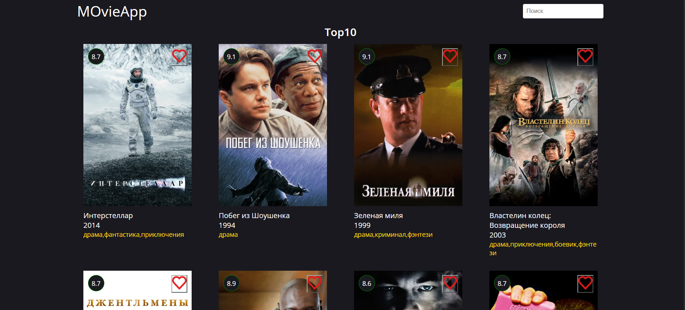

# 🎬 neobis_front_cinema

**movieApp**

**neobis_front_cinema** — учебный Frontend-проект, разработанный в рамках профессиональной стажировки в **Neobis**.

Проект представляет собой веб-приложение для просмотра каталога фильмов, вдохновлённое сервисом Кинопоиск. Пользователи могут знакомиться с подборками фильмов, просматривать различные категории и находить интересующие фильмы с помощью поисковой строки.

---

## 📸 Screenshots

---

## ✨ Features

- 🎬 **Movie Catalog** — просмотр каталога фильмов.
- 🔥 **Movie Categories** — разделение фильмов по категориям и подборкам.
- 🔎 **Search Functionality** — поиск фильмов по названию.
- 🆕 **Digital Releases** — просмотр новых цифровых релизов.
- ⭐ **Popular Movies** — подборки популярных и лучших фильмов.
- 🎨 **Interactive UI** — удобный и понятный пользовательский интерфейс.
- 📱 **Responsive Design** — адаптация интерфейса под разные размеры экранов.

---

## 🛠 Tech Stack

| Technology | Purpose |
|---|---|
| HTML5 | Структура веб-страницы |
| CSS3 | Стилизация и оформление интерфейса |
| JavaScript (ES6+) | Логика приложения и интерактивность |
| Images | Визуальное представление фильмов |

---

## 🧠 What I Learned

В процессе разработки проекта я получил практический опыт:

- Создания интерфейсов с использованием HTML и CSS.
- Работы с JavaScript и DOM.
- Реализации функциональности поиска.
- Фильтрации и отображения фильмов по категориям.
- Динамического взаимодействия с элементами страницы.
- Организации структуры Frontend-проекта.
- Создания пользовательского интерфейса для каталога контента.

---

## 💻 Usage

1. Откройте приложение по ссылке ниже.
2. Просматривайте фильмы на главной странице.
3. Выбирайте интересующие категории.
4. Используйте поисковую строку для поиска фильмов по названию.
5. Знакомьтесь с популярными фильмами и новыми цифровыми релизами.

---

## 👨‍💻 About the Project

**Developer:** Дастан Алмазбеков

**Role:** Frontend Developer

**Organization:** Neobis

**Project Type:** Movie Catalog Web Application

**Main Focus:** HTML, CSS, JavaScript, DOM

---

## 🔗 Live Demo

[movieApp](https://dosymuss.github.io/neobis_front_cinema/)

---

⭐ Thanks for checking out my project!
